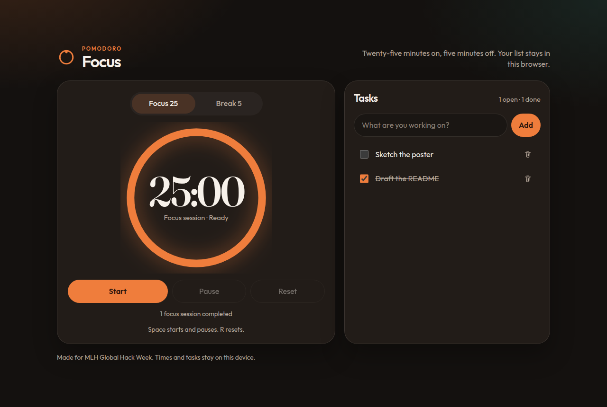

# Focus

A single-page Pomodoro timer and task list for MLH Global Hack Week. It is plain HTML, CSS, and JavaScript: 25 minutes of focus, a 5 minute break, and a task list saved in this browser.



## Features

- 25/5 timer with start, pause, and reset
- A chime and an on-screen message when a session ends, then the next session is ready
- Tasks you can add, complete, and delete
- Tasks and completed focus sessions saved in `localStorage`
- Layout that fits a phone or a desktop window

## Run it

Open `index.html` in a browser.

Or serve the folder and visit the URL it prints:

```bash
python3 -m http.server 8080
```

GitHub Pages can serve this repository from the root with no build and no extra config.

Space starts and pauses when focus is outside the task field. R resets the current session.

## Tests

Timer and task rules live in `js/timer.js` and `js/tasks.js`. `node:test` covers them with no dependencies:

```bash
node --test
```

`npm test` runs the same command.

## Built with Cursor

Cursor built this mini app from a short prompt during MLH Global Hack Week: the 25/5 timer, the task list that persists in localStorage, the responsive layout, and the Node test suite. The page is plain HTML, CSS, and JavaScript, so it runs by opening `index.html` or from GitHub Pages.
